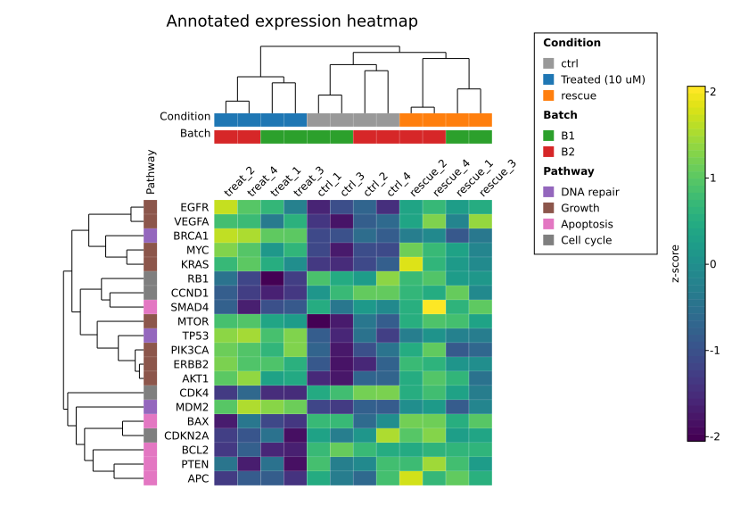
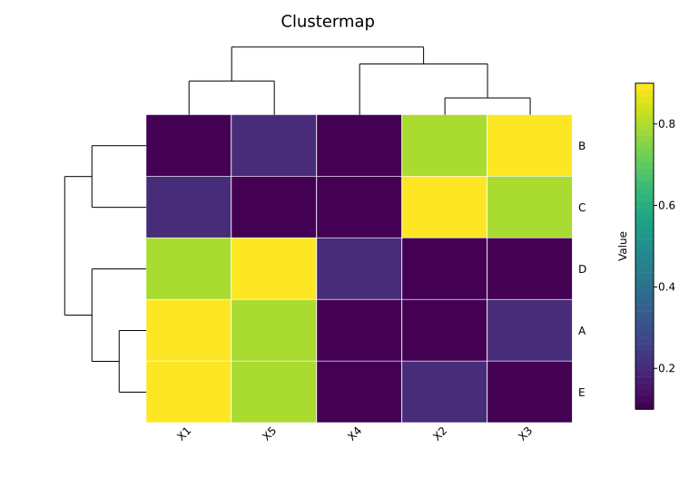
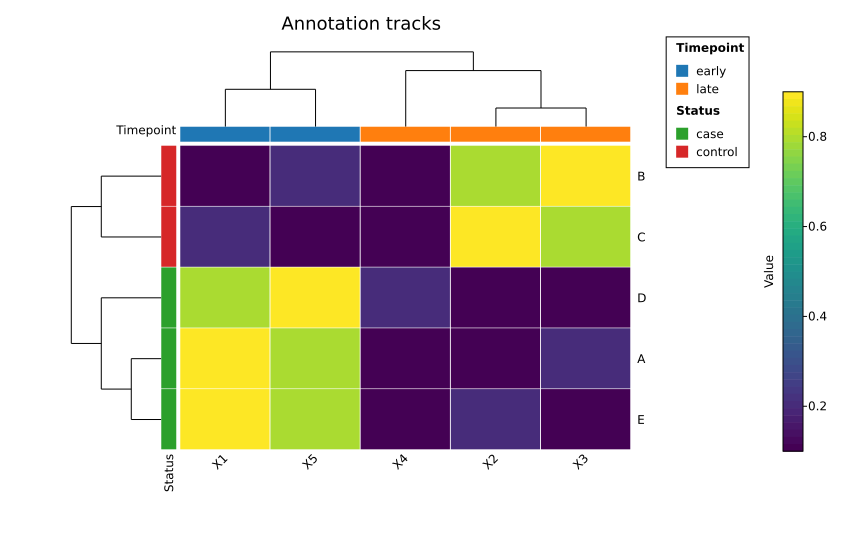
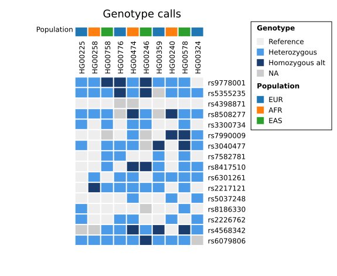
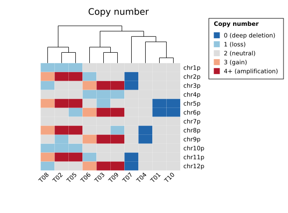
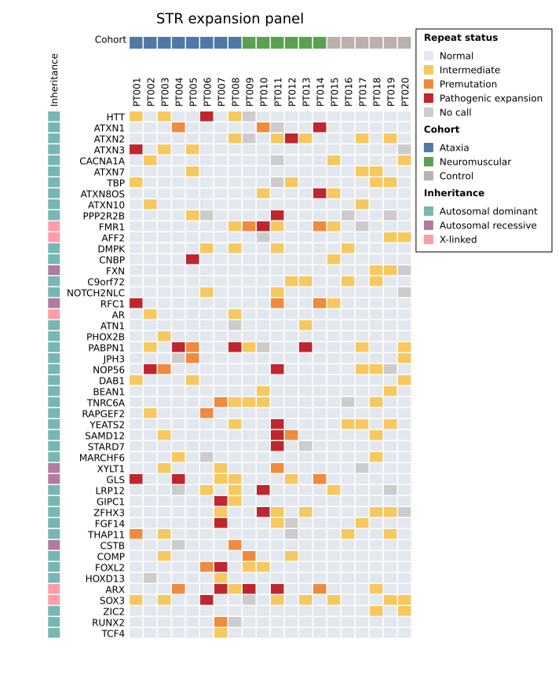
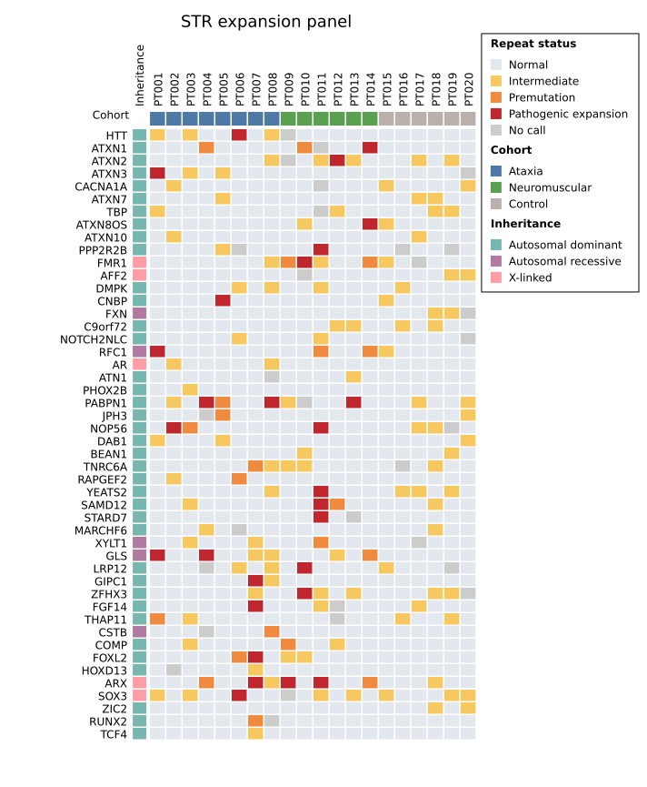

# Clustermap

A clustermap combines a heatmap with hierarchical clustering dendrograms for both rows and columns. Unlike composing a `Heatmap` and `PhyloTree` manually in a `Figure`, `Clustermap` computes both in the same renderer and guarantees **pixel-perfect alignment** between dendrogram leaves and heatmap cell centres.

Rows and columns are clustered automatically via UPGMA (Euclidean distance) unless clustering is disabled or a pre-built `PhyloTree` is supplied.

With clustering off it is also the place for **annotated heatmaps** (see [A large annotated table](#a-large-annotated-table) for a full worked example) (a "complex heatmap", or pheatmap with `annotation_row`/`annotation_col`): a large labelled matrix with metadata strips along the rows and columns, a legend that names every category, and optionally **categorical cells** such as genotype calls.



**Import path:** `kuva::plot::{Clustermap, ClustermapNorm, AnnotationTrack}` (plus `ColLabelSide`, `RowLabelSide`, `DiscreteColorMap` for the features below)

---

## Basic usage

Pass a 2-D grid to `.with_data()`. The outer dimension is rows (top to bottom) and the inner dimension is columns (left to right). Row and column labels are set directly on the `Clustermap`, not via `Layout`.

```rust,no_run
use kuva::prelude::*;

let data = vec![
    vec![0.9, 0.1, 0.2, 0.8, 0.1],
    vec![0.8, 0.2, 0.1, 0.9, 0.2],
    vec![0.1, 0.9, 0.8, 0.2, 0.9],
    vec![0.2, 0.8, 0.9, 0.1, 0.8],
    vec![0.1, 0.7, 0.8, 0.3, 0.9],
];

let cm = Clustermap::new()
    .with_data(data)
    .with_row_labels(["A", "B", "C", "D", "E"])
    .with_col_labels(["X1", "X2", "X3", "X4", "X5"])
    .with_legend("Value");

let plots = vec![Plot::Clustermap(cm)];
let layout = Layout::auto_from_plots(&plots).with_title("Clustermap");

let svg = SvgBackend.render_scene(&render_multiple(plots, layout));
std::fs::write("clustermap.svg", svg).unwrap();
```



Both dendrograms are drawn automatically. Rows and columns are reordered so that similar profiles cluster together.

---

## Disabling clustering

Pass `false` to `.with_cluster_rows()` or `.with_cluster_cols()` to suppress a dendrogram and keep the original data order on that axis.

```rust,no_run
# use kuva::prelude::*;
// Cluster rows only — keep original column order
let cm = Clustermap::new()
    .with_data(data)
    .with_row_labels(["A", "B", "C", "D", "E"])
    .with_col_labels(["X1", "X2", "X3", "X4", "X5"])
    .with_cluster_cols(false);

// Or disable both for a plain labeled heatmap via the Clustermap API
let cm_plain = Clustermap::new()
    .with_data(data)
    .with_row_labels(["A", "B", "C", "D", "E"])
    .with_col_labels(["X1", "X2", "X3", "X4", "X5"])
    .with_cluster_rows(false)
    .with_cluster_cols(false);
```

When clustering is disabled on an axis, no dendrogram panel is drawn for that axis and the data is displayed in its original order.

---

## Normalization

`.with_normalization(ClustermapNorm)` applies a transform to the data before color mapping. This is useful for comparing expression profiles where absolute magnitudes differ across rows or columns.

| Variant | Description |
|---------|-------------|
| `ClustermapNorm::None` | No transform — raw values mapped to colors. **Default.** |
| `ClustermapNorm::RowZScore` | Each row is z-score normalized (mean 0, std 1). |
| `ClustermapNorm::ColZScore` | Each column is z-score normalized (mean 0, std 1). |

```rust,no_run
# use kuva::prelude::*;
let cm = Clustermap::new()
    .with_data(data)
    .with_row_labels(["GeneA", "GeneB", "GeneC", "GeneD", "GeneE"])
    .with_col_labels(["Ctrl", "T1", "T2", "T3", "T4"])
    .with_normalization(ClustermapNorm::RowZScore)
    .with_legend("Z-score");
```


The colorbar always reflects the **post-normalization** range. Use `RowZScore` when you want to compare relative expression patterns across samples; use `ColZScore` when comparing relative feature activity across samples.

---

## Color maps

The same `ColorMap` enum used by `Heatmap` applies here.

```rust,no_run
# use kuva::prelude::*;
# use kuva::plot::ColorMap;
let cm = Clustermap::new()
    .with_data(data)
    .with_color_map(ColorMap::Inferno);
```

| Variant | Notes |
|---------|-------|
| `Viridis` | Perceptually uniform; colorblind-safe. **Default.** |
| `Inferno` | High-contrast; works in greyscale print. |
| `Grayscale` | Clean publication style. |
| `Custom(Arc<Fn>)` | Full control — closure maps `[0.0, 1.0]` to a CSS color string. |

---

## Annotation tracks

`AnnotationTrack` adds a strip of colored cells alongside the heatmap body: sample group, batch, condition, pathway. Row tracks sit between the row dendrogram and the body; column tracks between the column dendrogram and the body.

Give it the **category of each row or column, in the original data order**. The renderer reorders the strip to follow the clustering, picks a colour for each category, and adds a legend group titled with the track's label:

```rust,no_run
# use kuva::prelude::*;
# let data: Vec<Vec<f64>> = vec![];
let cm = Clustermap::new()
    .with_data(data)
    .with_row_labels(["A", "B", "C", "D", "E"])
    .with_col_labels(["X1", "X2", "X3", "X4", "X5"])
    .with_row_annotation(
        AnnotationTrack::categorical(["case", "control", "control", "case", "case"])
            .with_label("Status"),
    )
    .with_col_annotation(
        AnnotationTrack::categorical(["early", "late", "late", "late", "early"])
            .with_label("Timepoint"),
    )
    .with_legend("Value");
```



Add more tracks by calling `.with_row_annotation()` or `.with_col_annotation()` again. Colours never depend on hash order:

- Categories are listed, and take palette colours, in **order of first appearance**. `.with_category_order(["ctrl", "treat", "rescue"])` puts the named ones first.
- Tracks share the default palette (category10): each continues from where the previous one stopped, so two tracks don't reuse a colour until the palette runs out. `.with_palette(Palette::okabe_ito())` gives a track its own palette instead.
- `.with_category_color("ctrl", "#999999")` fixes one category's colour, and `.with_category_label("treat", "Treated (10 uM)")` changes its legend text.
- An empty value is missing: grey, and listed as `NA` in the legend.

```rust,no_run
# use kuva::prelude::*;
let condition = AnnotationTrack::categorical(["ctrl", "ctrl", "treat", "treat", "rescue"])
    .with_label("Condition")
    .with_category_color("ctrl", "#999999")
    .with_category_label("treat", "Treated (10 uM)")
    .with_category_order(["ctrl", "treat", "rescue"]);
```

`.with_annotation_legend(false)` on the `Clustermap` hides the annotation legend groups.

### Raw colours

`AnnotationTrack::new(colors)` takes one CSS colour per row or column instead of categories. It adds no legend entries, so use it when you want full control and will build any legend yourself.

### Track width

```rust,no_run
# use kuva::prelude::*;
# let values = vec!["a"];
let track = AnnotationTrack::categorical(values)
    .with_label("Treatment")
    .with_width(20.0);   // pixels; default 15.0
```

---

## Label placement

Column labels go below the body and row labels to the right by default. Move them with `.with_col_labels_position(ColLabelSide::Top)` and `.with_row_labels_position(RowLabelSide::Left)`. On the top or left the labels sit directly against the cells, between the body and any annotation strips and dendrogram, so each label starts at its own column or row. To put the strips against the cells instead, use `.with_annotation_placement(AnnotationPlacement::NextToCells)` (see the example below).

`.with_col_label_rotation(deg)` sets how steeply column labels slant: `45` (default), `90` for vertical labels in dense tables, or `0` for flat labels when the columns are wide enough to fit them. The band the labels need is measured from the labels themselves.

```rust,no_run
# use kuva::prelude::*;
# let data: Vec<Vec<f64>> = vec![];
let cm = Clustermap::new()
    .with_data(data)
    .with_col_labels_position(ColLabelSide::Top)
    .with_row_labels_position(RowLabelSide::Left)
    .with_col_label_rotation(90.0);
```

---

## Categorical cells

For a matrix of categories (genotype calls, mutation types, chromatin states) use `.with_categorical_data()` instead of `.with_data()`. Each category gets a colour and a swatch legend replaces the colour bar, titled by `.with_legend()`. Empty cells are missing (grey, `NA`).

```rust,no_run
# use kuva::prelude::*;
let calls = vec![
    vec!["ref", "het", "hom"],
    vec!["het", "het", ""],     // "" = no call
];
let cm = Clustermap::new()
    .with_categorical_data(calls)
    .with_category_colors([("ref", "#eeeeee"), ("het", "#4c9be8"), ("hom", "#1a3d6e")])
    .with_category_labels([("ref", "Reference"), ("het", "Heterozygous"), ("hom", "Homozygous alt")])
    .with_category_order(["ref", "het", "hom"])
    .with_legend("Genotype");
```



Clustering is turned off for categorical cells, since distances between labels mean nothing; pass a tree with `.with_row_tree()` / `.with_col_tree()` to order them. Normalization does not apply, and `.with_values()` prints each cell's category.

### Binned values

To colour **numbers** by bin instead of along a gradient, use a `DiscreteColorMap`. Each bin covers values from its start up to the next bin's start, and the last is open ended; values below the first bin are missing. Clustering and normalization still work on the numbers.

```rust,no_run
# use kuva::prelude::*;
use kuva::plot::DiscreteColorMap;
# let data: Vec<Vec<f64>> = vec![];
let copy_number = DiscreteColorMap::new()
    .with_bin(0.0, "#2166ac", "0 (deep deletion)")
    .with_bin(1.0, "#92c5de", "1 (loss)")
    .with_bin(2.0, "#dddddd", "2 (neutral)")
    .with_bin(3.0, "#f4a582", "3 (gain)")
    .with_bin(4.0, "#b2182b", "4+ (amplification)");
let cm = Clustermap::new()
    .with_data(data)
    .with_discrete_color_map(copy_number)
    .with_legend("Copy number");
```



---

## Big tables: cell size and gap

By default the table is fitted into the canvas, so cells shrink as the table grows. `.with_cell_size(w, h)` fixes every cell at `w` x `h` pixels and sizes the canvas around the table instead, so a big matrix gets a big figure and its labels stay readable. A `with_width` / `with_height` you set on the layout still wins for that dimension.

`.with_cell_gap(px)` sets the space between cells (the default is a hairline); `0.0` makes them touch.

```rust,no_run
# use kuva::prelude::*;
# let data: Vec<Vec<f64>> = vec![];
let cm = Clustermap::new()
    .with_data(data)
    .with_cell_size(14.0, 12.0)
    .with_cell_gap(1.0);
```

---

## Pre-supplied trees

Supply a `PhyloTree` directly with `.with_row_tree()` or `.with_col_tree()` to use a custom topology instead of auto-clustering. The tree's leaf labels must match the row (or column) labels set via `.with_row_labels()` / `.with_col_labels()`.

```rust,no_run
# use kuva::prelude::*;
let labels = ["A", "B", "C", "D", "E"];
let dist = vec![
    vec![0.0, 0.1, 0.9, 0.9, 0.9],
    vec![0.1, 0.0, 0.9, 0.9, 0.9],
    vec![0.9, 0.9, 0.0, 0.1, 0.2],
    vec![0.9, 0.9, 0.1, 0.0, 0.2],
    vec![0.9, 0.9, 0.2, 0.2, 0.0],
];

// Build a tree externally (UPGMA, Newick parse, etc.)
let row_tree = PhyloTree::from_distance_matrix(&labels, &dist);

let cm = Clustermap::new()
    .with_data(data)
    .with_row_labels(labels)
    .with_row_tree(row_tree)  // use this topology; skip auto-clustering
    .with_cluster_cols(true); // auto-cluster columns as normal
```

This is useful when you want to impose a known phylogeny on the rows while still auto-clustering the columns.

---

## Value overlay

`.with_values()` prints each cell's raw (post-normalization) value inside the cell, formatted to two decimal places. Most useful for small grids.

```rust,no_run
# use kuva::prelude::*;
let cm = Clustermap::new()
    .with_data(vec![
        vec![1.0, 4.0, 7.0],
        vec![2.0, 5.0, 8.0],
        vec![3.0, 6.0, 9.0],
    ])
    .with_row_labels(["R1", "R2", "R3"])
    .with_col_labels(["C1", "C2", "C3"])
    .with_values();
```

---

## Dendrogram panel sizing

The row dendrogram panel is 100 px wide by default. The column dendrogram panel is 80 px tall. Adjust these if your labels or canvas size require more or less space.

```rust,no_run
# use kuva::prelude::*;
let cm = Clustermap::new()
    .with_data(data)
    .with_row_dendrogram_width(60.0)   // narrower row dendrogram
    .with_col_dendrogram_height(50.0); // shorter col dendrogram
```

---

## Comparison with `Figure`-based `PhyloTree + Heatmap`

The older approach for pairing a dendrogram with a heatmap uses `Figure::new(1, 2)` to place a `PhyloTree` and a `Heatmap` side by side, then manually aligns them via `leaf_labels_top_to_bottom()` and `with_y_categories()`. This works but has a limitation:

> The tree leaves and heatmap rows are each spaced independently within their own figure cells. At most canvas sizes the alignment looks correct, but is not guaranteed to be pixel-exact.

`Clustermap` solves this by computing both the dendrogram and the heatmap body in the same renderer, sharing an identical `cell_h = hm_h / n_rows` formula. Every leaf centre and every heatmap row centre are placed at `hm_y + (k + 0.5) * cell_h` — the same expression — so alignment is guaranteed regardless of canvas size or the number of rows.

Use `Clustermap` when:
- You need reliable dendrogram-to-heatmap alignment.
- You want UPGMA auto-clustering and just need a result.
- You need annotation tracks alongside the heatmap.
- You want row / column z-score normalization in the same call.

Use the `Figure + PhyloTree + Heatmap` approach when:
- You need full control over the tree (e.g. circular layout, clade coloring, branch lengths, support values).
- You want to show a phylogram (branch-length-accurate tree) alongside the heatmap.
- The tree and heatmap use different data sources and need to be laid out independently.

---

## API reference

### `Clustermap` builder methods

| Method | Description |
|--------|-------------|
| `Clustermap::new()` | Create a clustermap with defaults |
| `.with_data(rows)` | Set grid data; accepts any numeric iterable of iterables |
| `.with_row_labels(iter)` | Row labels in original data order |
| `.with_col_labels(iter)` | Column labels in original data order |
| `.with_cluster_rows(bool)` | Enable/disable row clustering (default `true`) |
| `.with_cluster_cols(bool)` | Enable/disable column clustering (default `true`) |
| `.with_row_tree(PhyloTree)` | Pre-built row tree; overrides auto-clustering |
| `.with_col_tree(PhyloTree)` | Pre-built column tree; overrides auto-clustering |
| `.with_color_map(ColorMap)` | Color encoding (default `Viridis`) |
| `.with_values()` | Overlay raw cell values as text |
| `.with_normalization(ClustermapNorm)` | Normalization before color mapping (default `None`) |
| `.with_branch_color(s)` | Branch line color for both dendrograms (default `"black"`) |
| `.with_row_dendrogram_width(f64)` | Pixel width of the row dendrogram panel (default `100.0`) |
| `.with_col_dendrogram_height(f64)` | Pixel height of the column dendrogram panel (default `80.0`) |
| `.with_row_annotation(AnnotationTrack)` | Add a row annotation strip |
| `.with_col_annotation(AnnotationTrack)` | Add a column annotation strip |
| `.with_legend(s)` | Colour bar title, or the cell legend title for categorical / binned cells |
| `.with_tooltips()` | Enable SVG tooltip overlays on hover |
| `.with_col_labels_position(ColLabelSide)` | Column labels `Top` or `Bottom` (default) |
| `.with_row_labels_position(RowLabelSide)` | Row labels `Left` or `Right` (default) |
| `.with_col_label_rotation(f64)` | Column label slant in degrees, `0` to `90` (default `45`) |
| `.with_categorical_data(rows)` | Category text per cell instead of numbers; swatch legend, no clustering |
| `.with_category_colors(pairs)` | `(category, colour)` pairs for categorical cells |
| `.with_category_labels(pairs)` | `(category, legend text)` pairs for categorical cells |
| `.with_category_order(iter)` | Legend order for categorical cells |
| `.with_category_palette(Palette)` | Palette for categorical cells (default category10) |
| `.with_na_label(s)` | Legend text for missing cells (default `NA`) |
| `.with_discrete_color_map(DiscreteColorMap)` | Colour numeric cells by bin, with a swatch legend |
| `.with_annotation_legend(bool)` | Show the legend groups of categorical tracks (default `true`) |
| `.with_annotation_placement(AnnotationPlacement)` | Strips `OutsideLabels` (default) or `NextToCells`, where strips and labels share a side |
| `.with_cell_size(w, h)` | Fixed cell size in pixels; the canvas grows to fit |
| `.with_cell_gap(f64)` | Gap between cells in pixels |

### `AnnotationTrack` builder methods

| Method | Description |
|--------|-------------|
| `AnnotationTrack::categorical(values)` | Create a track from category values, in original data order; adds a legend group |
| `AnnotationTrack::new(colors)` | Create a track from CSS colours, in original data order; no legend |
| `.with_label(s)` | Strip label, and the legend group's title |
| `.with_width(f64)` | Strip width (row tracks) or height (col tracks) in pixels (default `15.0`) |
| `.with_palette(Palette)` | The track's own palette instead of the shared default |
| `.with_category_color(cat, colour)` | Fix one category's colour |
| `.with_category_label(cat, text)` | Legend text for one category |
| `.with_category_order(iter)` | Categories to list first, in this order |
| `.with_na_label(s)` | Legend text for missing values (default `NA`) |

### `ClustermapNorm` variants

| Variant | Effect |
|---------|--------|
| `None` | No normalization (default) |
| `RowZScore` | Each row normalized to mean 0, std 1 |
| `ColZScore` | Each column normalized to mean 0, std 1 |

---

## A large annotated table

This is the layout the annotation features are built for: one big rectangular table, read like a spreadsheet, with every row and column named and every colour explained. It shows repeat-expansion calls for 48 STR disease loci (rows) across 20 samples (columns), with a cohort strip over the columns and an inheritance strip down the rows. The calls are simulated.



```rust,no_run
use kuva::prelude::*;

# let loci: Vec<(&str, &str)> = vec![("HTT", "AD"), ("FXN", "AR"), ("FMR1", "XL")];
# let samples: Vec<String> = (1..=20).map(|i| format!("PT{i:03}")).collect();
# let cohort: Vec<&str> = vec!["Ataxia"; 20];
# let calls: Vec<Vec<String>> = vec![vec!["normal".to_string(); 20]; 3];
// loci:    (name, inheritance) per row, e.g. ("HTT", "AD"), ("FXN", "AR"), ("FMR1", "XL")
// samples: one ID per column; cohort: one cohort per column
// calls:   one row per locus, one call per sample: "normal", "intermediate",
//          "premutation", "pathogenic", or "" for no call
let cm = Clustermap::new()
    // The table: categorical cells, kept in input order (no clustering).
    .with_categorical_data(calls)
    .with_row_labels(loci.iter().map(|(l, _)| *l))
    .with_col_labels(samples)
    // Cell colours and legend text, listed in this order; empty cells read "No call".
    .with_category_colors([
        ("normal", "#e3e8ef"),
        ("intermediate", "#f6c85f"),
        ("premutation", "#f08a3e"),
        ("pathogenic", "#c0262d"),
    ])
    .with_category_labels([
        ("normal", "Normal"),
        ("intermediate", "Intermediate"),
        ("premutation", "Premutation"),
        ("pathogenic", "Pathogenic expansion"),
    ])
    .with_category_order(["normal", "intermediate", "premutation", "pathogenic"])
    .with_na_label("No call")
    .with_legend("Repeat status")
    // A strip across the columns and one down the rows, each with its own legend section.
    .with_col_annotation(
        AnnotationTrack::categorical(cohort)
            .with_label("Cohort")
            .with_category_color("Ataxia", "#4e79a7")
            .with_category_color("Neuromuscular", "#59a14f")
            .with_category_color("Control", "#bab0ac"),
    )
    .with_row_annotation(
        AnnotationTrack::categorical(loci.iter().map(|(_, m)| *m))
            .with_label("Inheritance")
            .with_category_color("AD", "#76b7b2")
            .with_category_color("AR", "#b07aa1")
            .with_category_color("XL", "#ff9da7")
            .with_category_label("AD", "Autosomal dominant")
            .with_category_label("AR", "Autosomal recessive")
            .with_category_label("XL", "X-linked")
            .with_category_order(["AD", "AR", "XL"]),
    )
    // Labels on top and left, sample IDs vertical; fixed cell size, small gaps.
    .with_col_labels_position(ColLabelSide::Top)
    .with_row_labels_position(RowLabelSide::Left)
    .with_col_label_rotation(90.0)
    .with_cell_size(18.0, 14.0)
    .with_cell_gap(1.5);

let plots = vec![Plot::Clustermap(cm)];
let layout = Layout::auto_from_plots(&plots).with_title("STR expansion panel");
let svg = SvgBackend.render_scene(&render_multiple(plots, layout));
std::fs::write("str_panel.svg", svg).unwrap();
```

How the pieces fit:

- **The legend** has one titled section per source of colour: the cells first (titled by `.with_legend()`), then each annotation strip (titled by its `.with_label()`). Each section lists its categories in the order you give, with your own wording, and a missing-value entry only if something is missing.
- **Labels** on the top and left sit right against the cells, so the eye runs straight from a name to its row or column. The strip labels sit on the same side: "Cohort" beside its strip, "Inheritance" reading up above its strip.
- **Size** comes from `.with_cell_size()`: the canvas is built around the table, so adding rows makes the figure taller instead of squashing the cells. With 48 rows and 20 columns the figure comes out taller than wide, like the table.
- **Strip placement**: by default the labels sit against the cells and the strips outside them. `.with_annotation_placement(AnnotationPlacement::NextToCells)` swaps them, putting the strips against the cells and the labels outside, so each strip reads as part of the table:

  

- **No clustering**: categorical cells keep the order you give, which is usually what you want for a panel like this (loci in a fixed order, samples grouped by cohort). For numeric data, call `.with_cluster_rows(false)` / `.with_cluster_cols(false)` to get the same plain table.

The CLI builds the same figure from a calls table and two metadata tables:

```bash
kuva clustermap calls.tsv --categorical \
    --row-annot loci.tsv:inheritance --col-annot samples.tsv:cohort \
    --category-colors "normal=#e3e8ef,intermediate=#f6c85f,premutation=#f08a3e,pathogenic=#c0262d" \
    --category-labels "pathogenic=Pathogenic expansion,AD=Autosomal dominant" \
    --na-label "No call" --legend "Repeat status" \
    --col-labels-top --row-labels-left --col-label-rotation 90 \
    --cell-size 18x14 --cell-gap 1.5 -o str_panel.svg
```

---

## CLI

`kuva clustermap` takes a wide matrix: the first column holds row labels and the header holds column labels (the same layout as `kuva heatmap`).

```bash
kuva clustermap expr.tsv --normalize row --legend "z-score"

# Annotated: strips from metadata tables, labels top and left
kuva clustermap expr.tsv --normalize row \
    --col-annot samples.tsv:condition --col-annot samples.tsv:batch \
    --row-annot genes.tsv:pathway \
    --category-colors "ctrl=#999999" --category-labels "treat=Treated (10 uM)" \
    --col-labels-top --row-labels-left --legend "z-score" -o annotated.svg

# Categorical cells
kuva clustermap genotypes.tsv --categorical \
    --category-colors "ref=#eeeeee,het=#4c9be8,hom=#1a3d6e" \
    --legend Genotype --col-labels-top --col-label-rotation 90 --cell-size 22
```

Annotation files are matched **by label, not by position**: the file's first column holds row (or column) labels and `:COLUMN` picks the category column (name or 0-based index, default 1). Its header becomes the strip label and legend title. Labels missing from the file are shown as `NA`, with a warning. The example files are in `examples/data/clustermap_*.tsv`.

| Flag | Meaning |
|------|---------|
| `--no-cluster-rows` / `--no-cluster-cols` | Keep input order on that axis (no dendrogram) |
| `--normalize row\|col\|none` | z-score each row or column before colouring |
| `--colormap <name>` | Colour map for numeric cells (default `viridis`) |
| `--categorical` | Cells are categories, not numbers |
| `--values` | Print each cell's value or category |
| `--legend <text>` | Colour bar or cell legend title |
| `--row-annot <FILE[:COL]>` / `--col-annot <FILE[:COL]>` | Annotation strip from a table, joined by label (repeatable) |
| `--category-colors <cat=colour,...>` | Category colours for strips and categorical cells; also sets legend order |
| `--category-labels <cat=text,...>` | Legend text for categories |
| `--na-label <text>` | Legend text for missing values (default `NA`) |
| `--no-annot-legend` | Hide the annotation legend groups |
| `--col-labels-top` / `--row-labels-left` | Move the labels |
| `--annot-next-to-cells` | Put the strips between the labels and the cells |
| `--col-label-rotation <deg>` | Column label slant, 0 to 90 |
| `--cell-size <W[xH]>` | Fixed cell size; the canvas grows to fit |
| `--cell-gap <px>` | Gap between cells |

NA tokens (`NA`, `NaN`, `null`, `.`, empty) are missing values in categorical cells and annotation files. Numeric cells must all be numbers, since clustering can't handle missing values. `--emit-code` prints the equivalent Rust.

**See also:** [Heatmap](./heatmap.md) for the un-clustered matrix, [Phylogenetic Tree](./phylo.md) for an explicit evolutionary tree instead of similarity clustering, [Dot Plot](./dotplot.md) for a size/color-encoded alternative.
