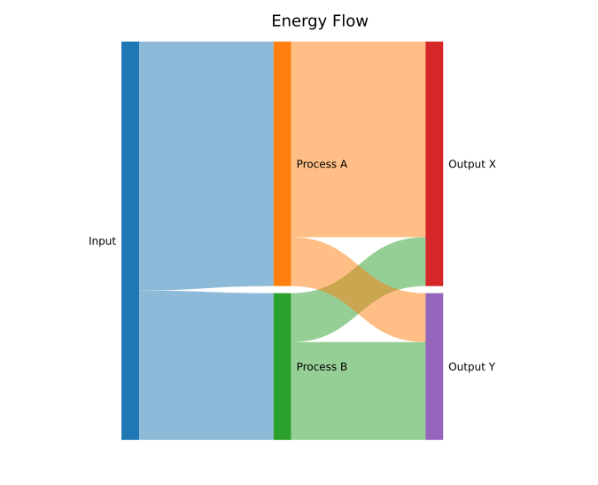
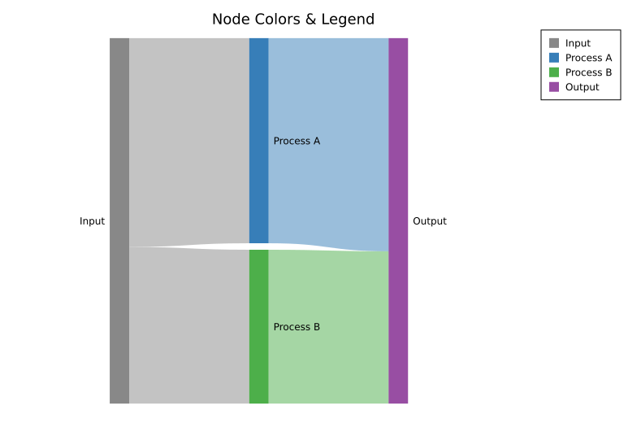
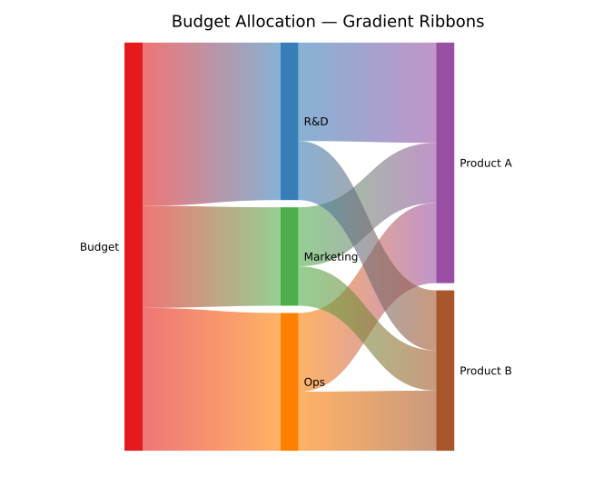
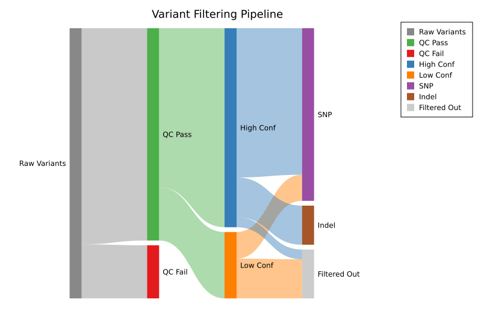

# Sankey Diagram

A Sankey diagram arranges nodes in columns and connects them with tapered ribbons whose widths are proportional to flow magnitude. It is well suited for showing multi-stage flows — energy transfer, budget allocation, data processing pipelines, or any directed network where quantities must be conserved through each stage.

**Import path:** `kuva::plot::SankeyPlot`

---

## Basic usage

Add directed links with `.with_link(source, target, value)`. Nodes are created automatically from the label strings; column positions are inferred by tracing the flow graph from left to right.

```rust,no_run
use kuva::plot::SankeyPlot;
use kuva::backend::svg::SvgBackend;
use kuva::render::render::render_multiple;
use kuva::render::layout::Layout;
use kuva::render::plots::Plot;

let sankey = SankeyPlot::new()
    .with_link("Input", "Process A", 50.0)
    .with_link("Input", "Process B", 30.0)
    .with_link("Process A", "Output X", 40.0)
    .with_link("Process A", "Output Y", 10.0)
    .with_link("Process B", "Output X", 10.0)
    .with_link("Process B", "Output Y", 20.0);

let plots = vec![Plot::Sankey(sankey)];
let layout = Layout::auto_from_plots(&plots)
    .with_title("Energy Flow");

let svg = SvgBackend.render_scene(&render_multiple(plots, layout));
std::fs::write("sankey.svg", svg).unwrap();
```



Node heights are proportional to the larger of incoming and outgoing flow at each node. Colors come from the default `category10` palette. Each label is printed to the left or right of its column.

---

## Node colors & legend

Set per-node fill colors with `.with_node_color(label, color)`. Call `.with_legend("")` to enable the legend; each node's name becomes an entry label automatically.

```rust,no_run
use kuva::plot::SankeyPlot;
use kuva::backend::svg::SvgBackend;
use kuva::render::render::render_multiple;
use kuva::render::layout::Layout;
use kuva::render::plots::Plot;

let sankey = SankeyPlot::new()
    .with_node_color("Input",     "#888888")
    .with_node_color("Process A", "#377eb8")
    .with_node_color("Process B", "#4daf4a")
    .with_node_color("Output",    "#984ea3")
    .with_link("Input",     "Process A", 40.0)
    .with_link("Input",     "Process B", 30.0)
    .with_link("Process A", "Output",    35.0)
    .with_link("Process B", "Output",    25.0)
    .with_node_width(24.0)
    .with_legend("Stage");

let plots = vec![Plot::Sankey(sankey)];
let layout = Layout::auto_from_plots(&plots)
    .with_title("Node Colors & Legend");

let svg = SvgBackend.render_scene(&render_multiple(plots, layout));
```



Ribbons inherit the source node color by default. To color nodes without linking them first (e.g. to control palette order), use `.with_node(label)` to declare a node explicitly before adding links.

---

## Link coloring

### Gradient ribbons

`.with_gradient_links()` renders each ribbon as a linear gradient from the source node color to the target node color.

```rust,no_run
use kuva::plot::SankeyPlot;
use kuva::backend::svg::SvgBackend;
use kuva::render::render::render_multiple;
use kuva::render::layout::Layout;
use kuva::render::plots::Plot;

let sankey = SankeyPlot::new()
    .with_node_color("Budget",    "#e41a1c")
    .with_node_color("R&D",       "#377eb8")
    .with_node_color("Marketing", "#4daf4a")
    .with_node_color("Ops",       "#ff7f00")
    .with_node_color("Product A", "#984ea3")
    .with_node_color("Product B", "#a65628")
    .with_link("Budget",    "R&D",       40.0)
    .with_link("Budget",    "Marketing", 25.0)
    .with_link("Budget",    "Ops",       35.0)
    .with_link("R&D",       "Product A", 25.0)
    .with_link("R&D",       "Product B", 15.0)
    .with_link("Marketing", "Product A", 15.0)
    .with_link("Marketing", "Product B", 10.0)
    .with_link("Ops",       "Product A", 20.0)
    .with_link("Ops",       "Product B", 15.0)
    .with_gradient_links()
    .with_link_opacity(0.6);

let plots = vec![Plot::Sankey(sankey)];
let layout = Layout::auto_from_plots(&plots)
    .with_title("Budget Allocation — Gradient Ribbons");

let svg = SvgBackend.render_scene(&render_multiple(plots, layout));
```



### Per-link colors

For full control, supply a color on each link individually with `.with_link_colored()`, then call `.with_per_link_colors()` to activate that mode:

```rust,no_run
# use kuva::plot::SankeyPlot;
let sankey = SankeyPlot::new()
    .with_link_colored("Budget", "R&D",       40.0, "#377eb8")
    .with_link_colored("Budget", "Marketing", 25.0, "#e41a1c")
    .with_link_colored("Budget", "Ops",       35.0, "#4daf4a")
    // …remaining links…
    .with_per_link_colors()
    .with_link_opacity(0.55);
```

---

## Bulk link loading

`.with_links()` accepts any iterator of `(source, target, value)` triples, which is convenient when links come from a data file or computed table:

```rust,no_run
# use kuva::plot::SankeyPlot;
let edges: Vec<(&str, &str, f64)> = vec![
    ("A", "B", 10.0),
    ("A", "C", 20.0),
    ("B", "D", 10.0),
    ("C", "D", 20.0),
];

let sankey = SankeyPlot::new().with_links(edges);
```

---

## Column layout

By default, columns are assigned by propagating each node one step further right than its leftmost source (BFS order). Use `.with_node_column(label, col)` to pin specific nodes to explicit columns when the automatic layout is incorrect — for example, when a node should appear in a later column despite having an early source:

```rust,no_run
# use kuva::plot::SankeyPlot;
let sankey = SankeyPlot::new()
    .with_node_column("Input",  0)
    .with_node_column("Middle", 1)
    .with_node_column("Output", 2)
    .with_link("Input",  "Middle", 80.0)
    .with_link("Input",  "Output", 20.0)   // skip link — goes directly to col 2
    .with_link("Middle", "Output", 80.0);
```

## Alluvium mode and ordering

For multi-stage categorical data, build a Sankey from full alluvia instead of pairwise edges. `.with_alluvium()` records one path across ordered axes, automatically creates axis-specific node IDs, and accumulates adjacent edge weights:

```rust,no_run
# use kuva::plot::SankeyPlot;
let sankey = SankeyPlot::new()
    .with_axis_names(["tissue", "cluster", "sex"])
    .with_alluvium(vec!["B CELL", "4", "male"], 9.0)
    .with_alluvium(vec!["BRAIN", "1", "female"], 1.0)
    .with_alluvium(vec!["HEART", "3", "male"], 3.0)
    .with_crossing_reduction()
    .with_left_coloring()
    .with_node_order_seed(42);
```

Use `.with_alluvia(iter)` to bulk-load alluvia from an iterator of `(strata, value)` rows.

### How crossing-reduction ordering works

The crossing-reduction algorithm minimises ribbon crossings by finding the best **vertical stacking order** of nodes within each column. The column sequence itself is always preserved exactly as you specified (left to right: tissue → cluster → sex in the example above).

Internally, the algorithm:

1. Builds a pairwise distance matrix over all nodes where two nodes with high co-occurrence in alluvia are assigned a short distance.
2. Runs a TSP heuristic (nearest-neighbour insertion + 2-opt) over that matrix to find a node cycle that clusters co-occurring nodes together.
3. Tries every rotation of the cycle, extracts the resulting within-column node ordering for each rotation, computes the weighted crossing objective (counting ribbon crossings weighted by flow), and keeps the rotation with the lowest score.

**Lode stacking within nodes:** when multiple ribbons enter or leave a single node (e.g. T CELL and B CELL both flowing into cluster "4"), the ribbon segments are stacked inside that node in the same top-to-bottom order as their sources in the adjacent column. This prevents unnecessary criss-crossing at the node boundary.

### Ordering modes

| Method | Behaviour |
|---|---|
| `.with_node_order(SankeyNodeOrder::Input)` | Preserve insertion order within each column (default) |
| `.with_crossing_reduction()` | TSP-based weighted crossing reduction |
| `.with_neighbornet()` | Alias for `.with_crossing_reduction()`, kept for compatibility |
| `.with_node_order_seed(seed)` | Fix the RNG seed for reproducible results (default `42`) |

`CrossingReduction` is a good general-purpose choice. `Neighbornet` is now the same as `CrossingReduction`: it used to try an external Python program, and that was removed because running a program while rendering a plot was unsafe.

### Coloring modes

| Method | Behaviour |
|---|---|
| `.with_node_coloring(SankeyNodeColoring::Label)` | One palette color per unique label, shared across all columns (default) |
| `.with_left_coloring()` | Each node inherits the color of its dominant left-side parent; new palette colors are allocated when no parent exceeds the cutoff |
| `.with_palette(colors)` | Override the fallback color list used by either mode |
| `.with_left_color_cutoff(f)` | Minimum parent-share (0.0–1.0) required for color inheritance in left mode (default `0.5`) |

---

## Bioinformatics example

A 4-stage variant filtering pipeline: raw variants pass QC, get classified by confidence level, and are split into variant types or discarded.

```rust,no_run
use kuva::plot::SankeyPlot;
use kuva::backend::svg::SvgBackend;
use kuva::render::render::render_multiple;
use kuva::render::layout::Layout;
use kuva::render::plots::Plot;

let sankey = SankeyPlot::new()
    .with_node_color("Raw Variants", "#888888")
    .with_node_color("QC Pass",      "#4daf4a")
    .with_node_color("QC Fail",      "#e41a1c")
    .with_node_color("High Conf",    "#377eb8")
    .with_node_color("Low Conf",     "#ff7f00")
    .with_node_color("SNP",          "#984ea3")
    .with_node_color("Indel",        "#a65628")
    .with_node_color("Filtered Out", "#cccccc")
    .with_link("Raw Variants", "QC Pass",       8000.0)
    .with_link("Raw Variants", "QC Fail",       2000.0)
    .with_link("QC Pass",      "High Conf",     6000.0)
    .with_link("QC Pass",      "Low Conf",      2000.0)
    .with_link("High Conf",    "SNP",           4500.0)
    .with_link("High Conf",    "Indel",         1200.0)
    .with_link("High Conf",    "Filtered Out",   300.0)
    .with_link("Low Conf",     "SNP",            800.0)
    .with_link("Low Conf",     "Filtered Out",  1200.0)
    .with_link_opacity(0.45)
    .with_legend("Stage");

let plots = vec![Plot::Sankey(sankey)];
let layout = Layout::auto_from_plots(&plots)
    .with_title("Variant Filtering Pipeline");

let svg = SvgBackend.render_scene(&render_multiple(plots, layout));
```



---

## API reference

| Method | Description |
|--------|-------------|
| `SankeyPlot::new()` | Create a Sankey plot with defaults |
| `.with_link(src, tgt, val)` | Add a directed link; auto-creates nodes from labels |
| `.with_link_colored(src, tgt, val, color)` | Add a link with an explicit ribbon color |
| `.with_links(iter)` | Bulk-add links from `(source, target, value)` triples |
| `.with_axis_names(iter)` | Set display names for ordered alluvium axes |
| `.with_alluvium(strata, value)` | Add one weighted alluvium spanning ordered axes |
| `.with_alluvia(iter)` | Bulk-add weighted alluvia |
| `.with_node(label)` | Declare a node without adding a link |
| `.with_node_color(label, color)` | Set a node's fill color (CSS color string) |
| `.with_node_column(label, col)` | Pin a node to a specific column (0-indexed) |
| `.with_node_width(px)` | Node rectangle width in pixels (default `20.0`) |
| `.with_node_gap(px)` | Minimum vertical gap between nodes in a column (default `8.0`) |
| `.with_gradient_links()` | Ribbons fade from source to target color |
| `.with_per_link_colors()` | Use per-link color set by `.with_link_colored()` |
| `.with_node_order(order)` | Choose `Input`, `CrossingReduction`, or `Neighbornet` node ordering |
| `.with_crossing_reduction()` | Use the default weighted crossing-reduction ordering |
| `.with_neighbornet()` | Alias for `.with_crossing_reduction()` |
| `.with_node_order_seed(seed)` | Set the ordering RNG seed |
| `.with_node_coloring(mode)` | Choose `Label` or `Left` coloring |
| `.with_left_coloring()` | Propagate colors left-to-right from dominant parents |
| `.with_palette(palette)` | Override the fallback Sankey palette |
| `.with_left_color_cutoff(f)` | Set the left-color dominant-parent threshold |
| `.with_link_opacity(f)` | Ribbon fill opacity `0.0`–`1.0` (default `0.5`) |
| `.with_legend("")` | Enable the legend; one entry per node, labeled with the node name |

### `SankeyLinkColor` variants

| Variant | Behavior |
|---------|----------|
| `Source` | Ribbon inherits the source node color **(default)** |
| `Gradient` | SVG `linearGradient` from source to target color |
| `PerLink` | Color from `.with_link_colored()` per ribbon |

### `SankeyNodeOrder` variants

| Variant | Behavior |
|---------|----------|
| `Input` | Preserve insertion order within each column **(default)** |
| `CrossingReduction` | Reduce weighted crossings using the default alluvial ordering backend |
| `Neighbornet` | Same as `CrossingReduction` (kept for compatibility) |

### `SankeyNodeColoring` variants

| Variant | Behavior |
|---------|----------|
| `Label` | Reuse one palette color per visible label **(default)** |
| `Left` | Propagate colors left-to-right from dominant parents |

**See also:** [Network Plot](./network.md) for a general node/edge graph, [Chord Diagram](./chord.md) for circular pairwise flows.

---

## CLI

Sankey / alluvial flow diagram.

`kuva sankey` supports two input modes:

- Edge-list Sankey input: source node, target node, flow value.
- Wide alluvium input: one ordered `--axis-col` per stage, plus an optional `--value-col`.

| Flag | Default | Description |
|---|---|---|
| `--axis-col <COL>` | repeatable | Ordered alluvium axis columns; switches the parser into wide alluvium mode |
| `--source-col <COL>` | `0` | Source node column |
| `--target-col <COL>` | `1` | Target node column |
| `--value-col <COL>` | `2` | Flow value column |
| `--link-gradient` | off | Fill each link with a gradient from source node colour to target node colour |
| `--opacity <F>` | `0.5` | Link opacity |
| `--legend <LABEL>` | — | Show legend |
| `--node-order <MODE>` | `input` | Node ordering within columns: `input` or `crossings` (`neighbornet` is accepted as an alias for `crossings`) |
| `--node-order-seed <N>` | `42` | RNG seed for crossing-reduction ordering |
| `--coloring <MODE>` | `label` | Node coloring mode: `label` or `left` |
| `--flow-labels` | off | Show absolute flow values on ribbons |
| `--flow-percent` | off | Show each ribbon as a percent of source outflow |
| `--flow-label-format <FMT>` | `auto` | Flow label number format: `auto`, `sci`, `integer`, `fixed2` |
| `--flow-label-unit <UNIT>` | — | Unit suffix appended to absolute flow labels |
| `--flow-label-min-height <F>` | `8.0` | Minimum ribbon height required to render a label |

### Edge-list mode

Use classic source-target-value input when your flow table is already stored as edges:

```bash
kuva sankey sankey.tsv \
    --source-col source --target-col target --value-col value

kuva sankey sankey.tsv \
    --source-col source --target-col target --value-col value \
    --link-gradient --legend "read flow"
```

### Alluvium mode

Use repeated `--axis-col` flags for ordered categorical stages. `kuva` will build full alluvia, aggregate adjacent links, and optionally apply wompwomp-style ordering and left-to-right color propagation:

```bash
kuva sankey alluvium.tsv \
    --axis-col tissue --axis-col cluster --axis-col sex \
    --value-col count \
    --node-order crossings \
    --node-order-seed 42 \
    --coloring left \
    --title "Ordered Alluvium"

kuva sankey alluvium.tsv \
    --axis-col tissue --axis-col cluster --axis-col sex \
    --value-col count \
    --node-order crossings \
    --coloring label \
    --title "Label Colouring"
```

`--node-order crossings` uses a TSP-based weighted crossing-reduction algorithm: it builds a co-occurrence distance matrix, finds a node cycle via nearest-neighbour + 2-opt, then tries every rotation to minimise the weighted ribbon-crossing count. The axis column order you specify with `--axis-col` is always preserved exactly — only the vertical stacking of nodes within each column is changed.

`--node-order neighbornet` is accepted as an alias for `crossings`.

`--coloring left` propagates colors from dominant parents left-to-right; `--coloring label` assigns one palette color per visible label.

---

*See also: [Shared flags](../cli/index.md#shared-flags) — output, appearance, axes, log scale.*
